# 施設間シフト下における MRI からの IDH 変異予測：判別は保たれ、較正はラベル無しの切片補正で回復する

**草稿 v0.4（2026-10-21）** — OpenIDH プロジェクトのここまでの成果を論文形式でまとめたもの。
数値は `results/` 以下の既存レポート・JSON からの転記。例外は 3.2 節の較正（年齢のみ・画像・画像 + 年齢）で、v0.4 で新たに計算した（`notebooks/08_age_baseline_calibration.ipynb`、Raiden で実行）。
`【要判断】` は人の判断が済んでいない箇所。

---

## 要旨

**背景** 脳グリオーマの IDH 変異を術前 MRI から予測するモデルは多いが、評価の多くは単一施設内の判別性能（AUC）にとどまり、未知の施設に持ち込んだときに確率値がどれだけ信用できるかはあまり調べられていない。公開ポータルとして配布するなら、判別だけでなく較正（予測確率と実際の陽性率の一致）が施設をまたいで成り立つ必要がある。

**方法** 米国の公開 3 コホート（UCSF-PDGM 501 例、UTSW 619 例、UPenn-GBM 515 例、計 1,635 例、変異率 18.0%）で、4 シーケンス（T1・T2・FLAIR・T1c）と年齢・性別を入力とする evidential late-fusion モデル（ViT-S/16 ×2 トランク、44.2M パラメータ）を学習した。施設 leave-one-site-out 2 条件、ベンダー（Philips）、磁場強度（3T）の 4 種類の分布シフトと分布内 5-fold を、3 seed ずつ計 27 ランで評価した。較正の崩れの原因を特徴空間で分解し、ラベルの要らない補正法を含む 10 種類あまりの事後補正を比べた。

**結果** 分布外の AUC は 0.860 ± 0.028 で、分布内（0.906 ± 0.014）から 0.046 しか下がらなかった。一方 ECE は 0.044 から 0.104 へ 2.4 倍に悪化した（最悪は LOSO-B の 0.162）。画像を使わない年齢 1 変数のロジスティック回帰は、分布外では画像モデルより AUC が高く（0.889 対 0.860）、両者を足すと 0.910 になった。画像の正味の寄与は年齢への上乗せ（+0.021）として測るべきである。較正でも、分布外の ECE は年齢のみ 0.068 が画像モデル 0.104 を下回った。一方、足し算の画像 + 年齢はスロープが全ユニットで 1 未満（平均 0.73）で、過信になった。この崩れはほぼ定数のロジットオフセット（切片のずれ）で、温度スケーリングや evidence の縮小では直らなかった。有病率をラベル無しで推定する EM 法は原理的に失敗した。**術前に分かる共変量（年齢と、高悪性度を疑うかどうかの 1 問）から目標施設の有病率を見積もり、モデル自身の出力の平均がそれに合うよう切片を解く「出力整合」**で、ラベル 0 例のまま LOSO-B の ECE は 0.162 → 0.042、LOSO-A は 0.082 → 0.038 まで下がり、全例ラベルで当てた切片（0.045・0.042）と同じ水準に届いた。少数例での誤補正を防ぐため、推定オフセットがブートストラップ SE の k 倍を超えたときだけ補正する有意性ゲート（k = 2.5、N_min = 20）を加えると、補正すべきずれの無い条件で害が出る確率は 47〜55% から 3〜6% に下がった。

**結論** 施設シフト下の較正誤差は主に切片の問題で、ラベル無しで直せる。ポータルでは順位と不確実性 S を常に返し、確率値は施設ごとに溜まった未ラベル症例から出力整合で補正する。補正はゲートが開いたときだけ適用し、補正の状態を画面に出す形が望ましい。

---

## 1. 序論

IDH 変異は WHO 2021 分類の中核で、予後と治療方針に直結する。術前 MRI から非侵襲に予測できれば手術計画に役立つが、臨床で使うには 2 つの条件を満たす必要がある。

1. **未知の施設でも順位付けが崩れないこと**（判別の頑健性）
2. **出力された確率値をそのまま読めること**（較正の頑健性）。閾値で判断したり、ほかの臨床情報と確率として統合したりするには、2 が要る

公開ポータル（以下 OpenIDH ポータル）は、学習に使っていない施設から症例が来ることが前提になる。その施設の確定診断ラベルは、ふつう手元に無いか、あっても少ない。そこで本研究は次の 3 つを問う。

- **RQ1** 施設・装置が変わったとき、判別と較正はそれぞれどれだけ劣化するか
- **RQ2** 較正の劣化の正体は何か（確信度の過剰か、切片のずれか、形の歪みか）
- **RQ3** 目標施設のラベルを使わずに、あるいはごく少数のラベルで、較正を取り戻せるか。それを安全に運用するにはどんな規則が要るか

---

## 2. 方法

### 2.1 データ

IDH 状態が分かっている症例だけを使った（NA は完全に除外）。患者単位でグループ化し、同じ患者が train と test にまたがらないようにしている。

| 施設 | n | 変異 | 野生型 | 変異率 | 備考 |
|---|---|---|---|---|---|
| UCSF-PDGM | 501 | 103 | 398 | 20.6% | 495 患者（6 患者が 2 セッション） |
| UTSW | 619 | 176 | 443 | 28.4% | QC 通過例。複数ベンダー・磁場強度が混在 |
| UPenn-GBM | 515 | 16 | 499 | 3.1% | GBM 限定コホート。変異が少ないので test には使わない |
| **計** | **1,635** | **295** | **1,340** | **18.0%** | |

前処理：1 mm 等方・256×256、脳マスク内で z-score、脳外は 0。腫瘍セグメンテーションから、腫瘍面積が最大の axial スライスとその上下 1 枚の計 3 枚を取り出し、3 チャンネルとして入力する。

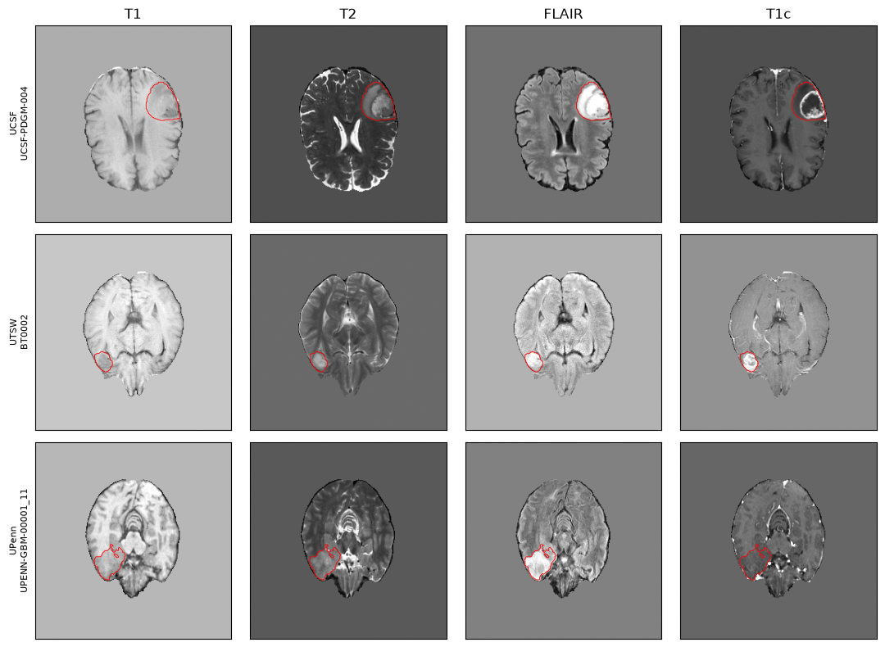

*図1 — 入力画像の例（`notebooks/01_data_check.ipynb`）。各施設から 1 例ずつ、選ばれた 3 スライスの中央 1 枚を 4 シーケンスで示した。赤線は腫瘍セグメンテーション。*

### 2.2 評価ユニット

分割は seed = 42 で固定し、すべての実験で同じ CSV を読む（`data/preprocessed/v1.0.0/_global/splits/`）。

| ユニット | 種類 | test | train | test の変異率（訓練側 inner-val） |
|---|---|---|---|---|
| LOSO-A | 施設シフト | UCSF（501） | UTSW + UPenn | 20.6%（16.7%） |
| LOSO-B | 施設シフト | UTSW（619） | UCSF + UPenn | 28.4%（11.8%） |
| vendor | 撮像シフト | UTSW Philips（140） | UTSW 他ベンダー | 35.0%（26.0%） |
| field | 撮像シフト | UTSW 3T（195） | UTSW 1.5T ほか | 27.2%（28.2%） |
| in-dist | 対照 | 全施設ランダム 5-fold（各 327） | 残り 4 fold | 約 18% |

各 train はさらに 80/20 で inner-train / inner-val に分け（患者グループ化、施設×IDH で層化）、early stopping と事後較正のフィットに使う。outer test は 1 回だけ評価する。vendor と field は UTSW の内部で症例構成がほぼ揃っているので、「撮像だけが変わる」条件として読める。

### 2.3 モデル

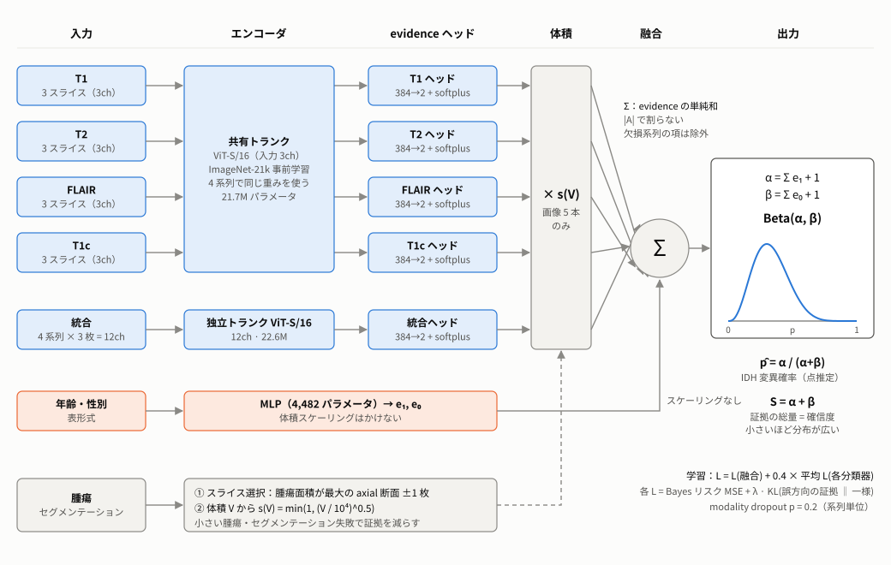

*図2 — OpenIDH モデルの構造。6 つの分類器（青：画像 5 本、橙：年齢・性別 1 本）が、それぞれ「変異を支持する証拠 e₁」と「野生型を支持する証拠 e₀」を出す。画像 5 本の証拠には腫瘍体積に応じた係数 s(V) を掛け、全分類器の証拠を単純に足し合わせて Beta(α, β) を作る。出力は確率 p̂ と、証拠の総量 S の 2 つ。*

#### 2.3.1 設計の考え方

このモデルは AUC の最大化ではなく、頑健性を目標に設計した。次の 4 点を不変条件にしている。

| # | 原則 | どう実現したか |
|---|---|---|
| 1 | 出力は 1 つの値ではなく確率分布にする | Beta 分布のパラメータ (α, β) を出力する（evidential deep learning） |
| 2 | 情報が少ないほど分布を広げる | シーケンスが欠けたときや腫瘍が小さいときに、証拠の総量 S が減る |
| 3 | どんなデータが来ても動く | シーケンスの欠損に耐える late fusion にする（融合後の共通表現を持たない） |
| 4 | 間違えるときは自信を持たない | 誤答時に S が下がることを、成功の判定条件に含める |

4 が最も重要な条件で、AUC が高くても不確実性が誤りと無相関なら、この設計は失敗とみなす。

#### 2.3.2 入力の作り方

腫瘍セグメンテーションから、腫瘍面積が最大の axial 断面とその上下 1 枚の計 3 枚を選ぶ。この 3 枚を 3 チャンネル画像として扱うと、RGB の 3 チャンネルで事前学習された ViT の重みをそのまま使える。統合分類器は 4 シーケンス × 3 枚 = 12 チャンネルを入力とし、パッチ埋め込み層だけを 12 チャンネル用に拡張する（timm の重みを 4 回並べて 1/4 倍する）。腫瘍体積 V はセグメンテーションから数えるが、分類器の入力には入れない。入れると、ネットワークが後述の s(V) を打ち消すように学習してしまうからである。

#### 2.3.3 6 つの分類器

| # | 分類器 | 入力 | エンコーダ | ヘッド |
|---|---|---|---|---|
| 1〜4 | T1 / T2 / FLAIR / T1c | 各シーケンスの 3 スライス（3ch） | **共有トランク** ViT-S/16（4 本で同じ重み） | シーケンスごとに独立（384→2、softplus） |
| 5 | 統合 | 4 シーケンス × 3 スライス（12ch） | 独立トランク ViT-S/16 | 独立（384→2、softplus） |
| 6 | 表形式 | 年齢・性別 | MLP | MLP の出力層 |

- **トランクを共有する理由**：4 シーケンスが同じ重みを通るので、共有トランクは 1 epoch に 4 倍（4 × 1,635 回）の順伝播を受ける。1,635 例という小さなデータでは、データを 4 倍に増やすのに近い効果がある。統合分類器は「シーケンス間の関係を読む」という別の仕事をするので、専用の重みを持たせた
- **ヘッドを分ける理由**：FLAIR と T1 では IDH についての情報量が違う。ヘッドを共有すると、シーケンスごとに自信の度合いを調整できなくなる
- **事前学習**：ViT-S/16、ImageNet-21k（AugReg）。脳 MRI 専用の基盤モデルは、3D 構成で設計と合わないか、ライセンス・公開状況が未確認だったため採用しなかった
- **パラメータ数**：共有トランク 21,665,664、統合トランク 22,550,400、evidence ヘッド 5 本で 3,850、表形式 MLP 4,482、合計約 44.2M（6 本とも独立にすると約 109.2M で、1,635 例には大きすぎる）

#### 2.3.4 証拠（evidence）と融合

分類器 k は、softplus を通して 0 以上の 2 つの値を出す。e₁⁽ᵏ⁾ は「変異を支持する証拠」、e₀⁽ᵏ⁾ は「野生型を支持する証拠」である。画像の 5 本には体積係数 s(V) を掛ける。

$$
s(V) = \min\left(1,\ \left(\frac{V}{V_{\mathrm{ref}}}\right)^{\gamma}\right), \qquad V_{\mathrm{ref}} = 10^4\ \text{voxel},\quad \gamma = 0.5
$$

V_ref は UTSW の腫瘍体積の下位 5% にあたり、全体の約 95% の症例では s(V) = 1 になる。強く効くのは、極端に小さい腫瘍か、自動セグメンテーションが腫瘍を取りこぼした症例である。後者のときは、選んだスライスに腫瘍が写っていない可能性が高い。s(V) は「その画像は信用しにくい」という事前知識を組み込んだもので、セグメンテーション失敗の検出器としても働く。

融合は、使える分類器の集合 A について証拠を**足すだけ**である。

$$
\alpha = 1 + \sum_{k \in A} e_1^{(k)}, \qquad \beta = 1 + \sum_{k \in A} e_0^{(k)}
$$

$$
\hat{p} = \frac{\alpha}{\alpha + \beta}, \qquad S = \alpha + \beta, \qquad z = \log\frac{\alpha}{\beta}
$$

- 和を |A| で割らない。割ると、シーケンスが欠けても S が下がらなくなり、原則 2 が壊れる
- 全分類器が欠けると α = β = 1、すなわち一様分布 Beta(1, 1)（「まったく分からない」）になる
- 融合ロジット z は、本研究の較正補正（2.7 節）が操作する量である。補正は z に定数 b を足すだけなので、順位（AUC）と S は変わらない

#### 2.3.5 損失関数

融合後の分布と、各分類器が単独で作る分布（その分類器の証拠だけで作った Beta）の両方に損失をかける。

$$
\mathcal{L} = \mathcal{L}^{\mathrm{fused}} + \lambda_{\mathrm{aux}} \cdot \frac{1}{|A|} \sum_{k \in A} \mathcal{L}^{(k)}, \qquad \lambda_{\mathrm{aux}} = 0.4
$$

各項は、データ項と正則化項の和である。

$$
\mathcal{L}_{\mathrm{data}} = \left(y - \hat{p}\right)^2 + \frac{\hat{p}\left(1 - \hat{p}\right)}{S + 1}
$$

$$
\mathcal{L}_{\mathrm{reg}} = \mathrm{KL}\left(\mathrm{Beta}(\tilde{\alpha}, \tilde{\beta}) \,\|\, \mathrm{Beta}(1, 1)\right)
$$

- **データ項**は、Beta 分布で確率を引いたときの二乗誤差の期待値（Bayes リスク）である。第 1 項は外れの大きさ、第 2 項は分布の広さで、証拠が少ない（S が小さい）ほど大きくなる。だから「当てる」と同時に「証拠を集める」動機が生まれる
- **正則化項**は、正解側の証拠を取り除いた分布（y = 1 なら α̃ = 1、β̃ = β）と一様分布との KL である。**間違った方向の証拠だけ**を罰し、正解方向の証拠には一切罰がかからない。2 値の場合は、誤方向の証拠を w = e_wrong + 1 として log w − (w − 1)/w という単純な形になる
- 正則化の重み λ_t は 0 から 0.1 まで 15 epoch かけて線形に上げる。最初から強いと、証拠が立ち上がらない
- **補助損失**（各分類器への損失）が要るのは、融合の損失だけだと一部の分類器が「サボる」ことがあるからである。たとえば T2 と FLAIR で十分当たると、T1 の証拠を 0 にしても融合の損失は下がる。その場合、本番で T2 と FLAIR が欠けた症例が来ると何も言えなくなる
- クラス重み付けはしない（事前確率が歪み、較正が悪くなるため）

#### 2.3.6 学習設定

AdamW（lr 1e-4、weight decay 0.05、warmup 3 epoch）、batch 32、最大 200 epoch。early stopping は inner-val の NLL で判定する（patience 20）。AUC は確信度の強さに反応しないので、停止の判定には使わない。modality dropout はシーケンス単位で各 p = 0.2 とし、少なくとも 1 シーケンスは残す。T1 を落とすと、T1 分類器と統合分類器の T1 チャンネルの両方が消える。年齢・性別は落とさない。A100 40GB 1 枚で、1 ランあたり約 1 時間かかった。実際には全 27 ランが 24〜40 epoch で早期終了し、最良 epoch の平均は 8 だった。

### 2.4 なぜ Beta 分布を使うのか

IDH 変異の有無は 2 値なので、モデルが本当に知りたいのは「この症例が変異である確率 p」である。ふつうの分類器は p を 1 つの値で出す。しかし同じ「p = 0.3」でも、十分な画像証拠に基づく 0.3 と、ほとんど何も分からないままの 0.3 とでは、臨床での重みが違う。1 つの値では、この違いを表せない。

Beta 分布は、0〜1 の値をとる確率 p そのものの分布である。パラメータ α − 1 と β − 1 は「変異を支持する証拠の量」と「野生型を支持する証拠の量」と読め、仮想的な症例数のように扱える。平均と分散は次のとおりである。

$$
\mathbb{E}[p] = \frac{\alpha}{S}, \qquad \mathrm{Var}[p] = \frac{\hat{p}\left(1 - \hat{p}\right)}{S + 1}
$$

つまり、**分布の中心（p̂）が「どちらに傾いているか」を、総量（S）が「その判断がどれだけの証拠に支えられているか」を表す**。この 2 つを分けて持てることが、Beta を使う最大の理由である。

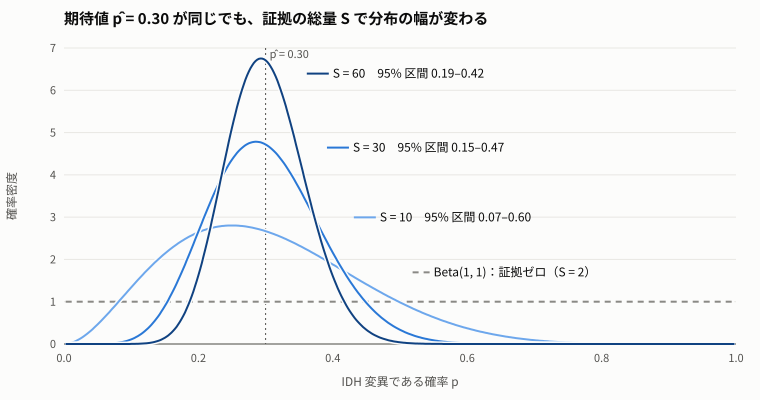

*図3 — 期待値 p̂ = 0.30 が同じ 3 つの Beta 分布と、証拠ゼロの Beta(1, 1)。S = 10 では 95% 区間が 0.07〜0.60 と広く、S = 60 では 0.19〜0.42 まで狭まる。*

**期待される効果**

1. **確率と確信度を分けて返せる** 同じ p̂ = 0.30 でも、S = 10 なら 95% 区間は 0.07〜0.60、S = 60 なら 0.19〜0.42 になる（図3）。ポータルでは「確率」と「その確率をどこまで信じてよいか」を別々に示せる
2. **情報が少ないと自動で分布が広がる** Beta はベルヌーイ分布の共役事前分布で、「証拠を足す」ことがそのままベイズ更新になる。だから融合は単純な和でよく、欠けた分類器はその項が消えるだけで済む。各分類器の証拠が 10 なら、全 6 本揃えば S = 62（95% 区間幅 0.25）、T1 が欠けると統合分類器も含めて 2 本が抜けて S = 42、3 シーケンスが欠けると S = 22 になる。腫瘍が小さいときも s(V) を通して同じことが起きる。どちらも「情報が少なければ自信を持たない」という 1 つの原理から出てくる
3. **間違えるときに自信を落とすように学習できる** 正則化項は誤方向の証拠だけを罰するので、モデルは「正解に自信を持つ」のは自由で、「間違った方向に自信を持つ」ことだけを抑えられる。実際に 27 ランすべてで、誤答例の S が正答例より低かった（平均 −24%、3.1 節）
4. **融合の中身が読める** 確率は各分類器の証拠の和から決まるので、どの分類器がどれだけ効いたかをそのまま読める。T1c の証拠が大きく年齢がほとんど使われていないという所見や、ヘッドを外す実験（実験 B）が、再推論なしの算術で済んだのはこの性質のおかげである
5. **較正補正と両立する** 確率は融合ロジット z = log(α/β) を通して決まるので、切片補正は z に定数を足すだけで済み、S と順位はそのまま残る。ポータルでは「施設ごとに較正した確率」と「症例ごとの確信度 S」を独立に出せる
6. **追加コストが無い** MC dropout やアンサンブルのように何度も推論する必要がなく、1 回の forward で分布が得られる

**できないこと（本研究で分かった限界）**

- **S は「施設が変わったこと」を検知しない**：out-site の S は in-site より平均 −5% しか下がらなかった。損失に施設の情報が入っていないので、当然の帰結である（3.1 節）
- **分布外での確率の目盛りのずれは、Beta にしても直らない**：切片のずれは別途補正が要る（3.3〜3.5 節）
- **和による融合は、分類器を独立な証拠として数える**：実際には 6 本が同じ症例の画像を見ており、共有トランクも使っている。そのため証拠を二重に数えて過信になる恐れがある。設計では「各分類器は単独で欲しい確信度の 1/6 程度を出すべき」とし、融合後の S の目標を 30〜60 と置いた。実測の S は正答例で 20〜64 で、おおむね目標の範囲に収まった

### 2.5 評価指標

AUC、AUPRC（有病率で割った lift も併記）、ECE（10 ビン等幅）、Brier、NLL、閾値 0.5 での感度・特異度。不確実性の検証として、正答例と誤答例の S（Dirichlet strength）の中央値を比べた。

### 2.6 原因分析（実験 A〜C、既存チェックポイントでの推論のみ）

- **実験 A：シフトの特徴空間分解** 各ヘッドは 384 次元のうち 2 方向しか読まない。そこで val → test の平均特徴の移動 Δ を、判別方向 `u_p`、確信方向 `u_s`、ヘッドから見えない成分 `Δ_null` に分けた。val を半分に分けるブートストラップで雑音床を作り、効果量はそれとの比で示す。grade × 年齢で層別すると、症例構成による寄与と撮像による寄与を分けられる
- **実験 B：ヘッドの除去とシーケンス欠損** 融合の和から項を外す *head-off* と、入力チャネルを 0 にして forward する *true-missing* を比べた
- **実験 C：自信過剰仮説の検証** 症例ごとの分布外スコア（特徴空間での距離）と、evidence 全体を定数倍で縮める補正

### 2.7 較正補正法

以下はすべて融合ロジット `z_i = log(α_i / β_i)` に対する単調変換なので、**AUC と順位は動かない**（evidence 縮小だけは Beta の +1 があるため厳密には単調でなく、AUC の変化は最大 0.005）。

補正法は、何の情報を使うかで 4 つの系統に分けられる。

| 系統 | 手法 | 目標施設で使う情報 | 推定するもの |
|---|---|---|---|
| **(i) inner-val でフィット** | 温度スケーリング | なし | 傾き T |
| | evidence 定数縮小 | なし | 確信度の水準 c |
| **(ii) 有病率を推定してから比を取る** | EM prior shift（SLD 法） | 予測確率の分布 | 有病率 |
| | 比方式・年齢のみ | 年齢分布 | 有病率比 |
| | 比方式・年齢 + 疑い | 年齢 + 術前の高悪性度疑い（2 値） | 有病率比 |
| | 比方式・CBTRUS | 外部疫学表（grade 別 IDH 頻度） | 有病率比 |
| **(iii) 出力整合** | 出力整合・年齢 + 疑い（**提案法**） | 年齢 + 疑い + **モデル自身の出力** | 切片 b を直接 |
| **(iv) ラベルあり** | N 例ラベルの切片 | N 例の確定診断 | 切片 b |
| | prior オラクル / 全例ラベル切片 | 全例の確定診断 | 上限の参照値（配備はできない） |

**記号** 症例 i の年齢を `a_i`、疑い（0 / 1）を `g_i` と書く。訓練施設で当てたロジスティック回帰 π(a, g) は、その症例が IDH 変異である確率を共変量だけから見積もる。σ はシグモイド関数、logit はその逆関数である。

**比方式（間接標準化）** 訓練側（inner-val）と目標施設の症例を、同じ π に通して平均有病率を出す。訓練側を `π̂_src`、目標施設を `π̂_tgt` とし、次の b を融合ロジットに足す。

$$
b_{\mathrm{ratio}} = \mathrm{logit}\left(\hat{\pi}_{\mathrm{tgt}}\right) - \mathrm{logit}\left(\hat{\pi}_{\mathrm{src}}\right)
$$

症例構成（有病率）が動いた分しか捉えられない。

**出力整合（output matching）** 目標施設の N 例について、次の式を満たす b を求める。

$$
\frac{1}{N}\sum_{i=1}^{N}\sigma\left(z_i + b\right) \;=\; \hat{\pi}_{\mathrm{cov}} \;=\; \frac{1}{N}\sum_{i=1}^{N}\pi\left(a_i, g_i\right)
$$

左辺は「補正後のモデル出力の平均」、右辺は「共変量から見積もった目標施設の有病率」である。b は brentq で解く（左辺は b について狭義単調増加なので、解はただ 1 つ）。有病率は共変量から決め、「今のモデルがそこからどれだけずれているか」をモデル自身の出力で測る。比方式と違って、**撮像が原因の切片ずれも捉えられる**。また EM と違って、有病率の推定がモデルの出力を経由しないので循環が生じない。疑いが不明な症例には年齢のみの π を使う。
*検算*：右辺を真の有病率に置き換えると、この式は切片だけの最尤推定のスコア方程式と一致する。全 27 ランで、別途直接最小化した MLE と最大 3.1e-8 で一致した。

**疑い（suspicion）の操作的定義** ポータルでは「術前画像で高悪性度（grade 4）を疑うか」を 1 問だけ尋ねる想定。本評価では確定 WHO grade を 2 値化した値（4 → 1、2/3 → 0）で代用した。誤読の頑健性は、15% の反転（周辺分布を保つ）と 25〜100% の欠損で確かめた。grade を 3 値で入れても 2 値と同じ答えになったので、2 値の 1 問で足りる。

**有意性ゲート** N 例の中だけで 200 回の復元抽出を行い、b̂ のブートストラップ SE を求める。|b̂| > k × SE かつ N ≥ `N_min` のときだけ補正する。k と N_min は事前に固定した規則で選んだ：**N ≥ 20 のすべての N・すべてのユニットで P(害 > 0.01) < 10% を満たす k のうち、LOSO-B の利得損失が最小のもの**。害とは、補正後の ECE が補正なしを上回ることを指す。

**N 依存性の評価** 各 N（5〜200）で目標施設から N 例を抽出し、その N 例だけでオフセットを推定する。ECE は**残りの症例**で測る（50 回 × 3 seed）。ゲートの判定は N 例の情報と訓練側の定数だけを読み、残りの症例は採点にしか使わないことをコードとテストで確かめた。

### 2.8 比較対象：画像を使わないモデル

画像が年齢にどれだけ上乗せしているかを測るため、**年齢 1 変数のロジスティック回帰**（罰則なし）を比較対象にした。各評価ユニットの訓練側で当て、test 症例の年齢に適用する。目標施設のラベルは使わない。年齢モデルは seed に依存しないので 1 本、画像モデルは 3 seed の平均で比べる。

あわせて、両者を足した「画像 + 年齢」のスコアも測った。融合ロジット z に、年齢の対数オッズから訓練側の有病率の対数オッズを引いた分を足す。

$$
z_{\mathrm{comb}} = z + \left[ \operatorname{logit} \pi(a) - \operatorname{logit} \bar{y}_{\mathrm{train}} \right]
$$

これは naive Bayes 型の足し算で、モデルを学習し直したものではない。性別は入れていない。性別のみ・年齢 + 性別のモデルは評価していない。較正は、AUC・ECE・NLL・Brier に加えて、較正切片（傾きを 1 に固定したロジットのオフセット）と較正スロープ（ロジスティック再較正 a + s·logit p の s）で比べた。

---

## 3. 結果

### 3.1 判別は保たれ、較正は崩れた（RQ1）

| ユニット | 条件 | n | AUC | ECE | Brier |
|---|---|---|---|---|---|
| LOSO-A | 分布外 | 501 | 0.856 ± 0.021 | 0.082 ± 0.025 | 0.122 |
| LOSO-B | 分布外 | 619 | 0.854 ± 0.019 | **0.162 ± 0.018** | 0.177 |
| vendor | 分布外 | 140 | 0.867 ± 0.053 | 0.085 ± 0.019 | 0.141 |
| field | 分布外 | 195 | 0.861 ± 0.024 | 0.088 ± 0.004 | 0.122 |
| in-dist | 分布内 | 5 × 327 | 0.906 ± 0.014 | 0.044 | 0.085 |

（± は 3 seed の標準偏差）

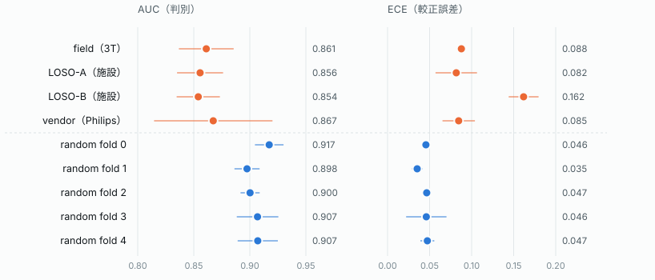

*図4 — ユニットごとの AUC（左）と ECE（右）。点は 3 seed の平均、横線は標準偏差。破線より上が分布外の 4 ユニット。AUC は 0.85〜0.87 に揃うが、ECE は分布外で散らばる。*

- 性質の違う 4 種類のシフトで、AUC は 0.854〜0.867 の狭い幅に収まった
- AUPRC は 0.738 → 0.727 とほぼ横ばいに見えるが、分布外のほうが有病率が高い（27.8% 対 18.0%）ことに助けられているだけで、lift で見ると 4.09 → 2.62 と 36% 落ちている
- 分布外の信頼度図は、どの確率帯でも対角線より上にあった（過小評価）。LOSO-B のずれをロジットで測ると、ビンをまたいで **+1.42 ± 0.17 とほぼ一定**だった。これは定数のロジットオフセットの形そのものである（図5）
- **不確実性**：27 ランすべてで、誤答例の S は正答例より低かった（平均 −24%、例外なし）。一方、同じモデルに in-site と out-site のデータを通して比べると、out-site の S は平均 −5% しか下がらなかった。S は「間違えていること」には強く反応するが、「施設が変わったこと」にはほとんど反応しない。evidential loss にドメインの情報が入っていない以上、これは設計どおりの帰結である（図6）
- **画像を使わないモデルとの比較**は 3.2 節にまとめた

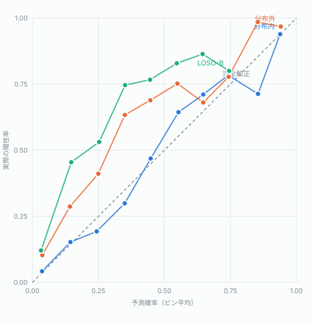

*図5 — 信頼度図。予測確率を 10 ビンに分け、各ビンの平均予測確率（横軸）と実際の陽性率（縦軸）を取った。対角線が完全較正。分布外はどの確率帯でも対角線より上にある（過小評価）。*

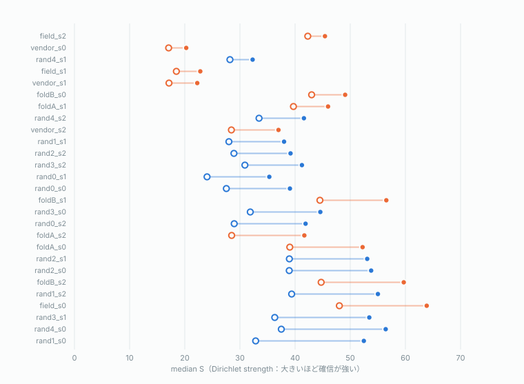

*図6 — 正答例と誤答例の median S。1 行が 1 ラン。27 ランすべてで誤答時のほうが低い。*

### 3.2 画像を使わないモデルとの比較

**年齢だけで、分布外の AUC は画像モデルを上回った。** 分布外の 4 ユニットすべてで、年齢 1 変数のロジスティック回帰が 44M パラメータの画像モデルより高かった（平均 0.889 対 0.860）。分布内ではほぼ互角だった（0.898 対 0.906）。

**AUC：年齢のみ・画像モデル・画像 + 年齢（test、画像は 3 seed 平均）**

| ユニット | 条件 | test 例数 | 年齢のみ | 画像モデル | 画像 + 年齢 | 年齢のみ − 画像 |
|---|---|---|---|---|---|---|
| LOSO-A（UCSF） | 分布外 | 501 | 0.904 | 0.856 | 0.919 | +0.049 |
| LOSO-B（UTSW） | 分布外 | 619 | 0.880 | 0.854 | 0.907 | +0.026 |
| vendor（Philips） | 分布外 | 140 | 0.905 | 0.867 | 0.920 | +0.038 |
| field（3T） | 分布外 | 195 | 0.868 | 0.861 | 0.896 | +0.007 |
| random fold 0 | 分布内 | 327 | 0.877 | 0.917 | 0.928 | −0.040 |
| random fold 1 | 分布内 | 327 | 0.891 | 0.898 | 0.911 | −0.006 |
| random fold 2 | 分布内 | 327 | 0.889 | 0.900 | 0.920 | −0.012 |
| random fold 3 | 分布内 | 327 | 0.926 | 0.907 | 0.955 | +0.019 |
| random fold 4 | 分布内 | 327 | 0.907 | 0.907 | 0.936 | +0.000 |
| **平均** | **分布外** | | **0.889** | **0.860** | **0.910** | **+0.030** |
| **平均** | **分布内** | | **0.898** | **0.906** | **0.930** | **−0.008** |

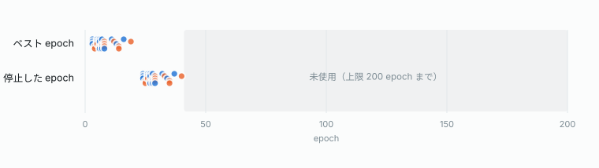

*図7 — 年齢のみのロジスティック回帰と画像モデルの AUC。右端は「年齢のみ − 画像モデル」。破線より上が分布外。年齢モデルは訓練側で当てて test の年齢に適用しており、目標施設のラベルは使っていない。*

- **画像に価値がないという結果ではない**：年齢はシフトでほとんど劣化しない（0.898 → 0.889）が、画像は劣化する（0.906 → 0.860）。分布外で順位が入れ替わるのは、年齢が強くなるからではなく画像が弱くなるからである
- **足すと常に単独を上回る**：画像 + 年齢は 9 ユニットすべてで両方の単独より高かった（分布外 0.910、分布内 0.930）。画像の正味の寄与は、年齢への上乗せとして分布外で +0.021、分布内で +0.032 と測るのが正確である
- **現行モデルは年齢を使い切れていない**：モデルは年齢・性別を入力に持っているのに、画像モデル単体（0.860）は年齢単独（0.889）を下回った。tabular head の evidence は平均 1.26 で、ほかのヘッド（6〜12）より一桁小さい。それでも、tabular head を外すと AUC は −0.007 下がり、分布外 12 ランのうち改善したランは 1 つもなかった（実験 B）。わずかには効いているが、外で足した年齢（+0.051）にはまったく届いていない
- **学習率で年齢の効き方は変わる**：tabular head を含むヘッドだけ学習率を 30 倍（3e-3）にすると、tabular evidence は 1.29 → 10.28 に増え、閾値 0.5 での感度は 10.2% → 28.4% に改善した（LOSO-B、3 seed とも +17〜19pt、特異度の低下は 0.8pt）。一方 AUC の変化（平均 +0.017、seed 別 +0.001 / −0.012 / +0.063）は seed 間のばらつき（sd 0.026）より小さく、効果は検出できなかった。この介入はロジット全体を平行移動させる効果が主で、学習で内部化された切片補正とみなせる

**較正でも、分布外では年齢のみが画像モデルより良かった。** 分布外 4 ユニットの平均 ECE は、年齢のみ 0.068、画像 + 年齢 0.073、画像モデル 0.104 で、4 ユニットすべてで年齢のみが画像モデルを下回った。ただし vendor では差が小さかった（0.076 対 0.085）。分布内では 3 者とも 0.04〜0.05 だった。

**較正：年齢のみ・画像モデル・画像 + 年齢（test、画像は 3 seed 平均。`notebooks/08_age_baseline_calibration.ipynb`）**

| ユニット | 有病率 train→test | ECE 年齢のみ | ECE 画像 | ECE 画像 + 年齢 | 切片 年齢のみ | 切片 画像 | 切片 画像 + 年齢 | スロープ 年齢のみ | スロープ 画像 | スロープ 画像 + 年齢 |
|---|---|---|---|---|---|---|---|---|---|---|
| LOSO-A（UCSF） | 17.0%→20.6% | **0.034** | 0.082 | 0.041 | +0.07 | +0.84 | +0.39 | 1.18 | 1.09 | 0.81 |
| LOSO-B（UTSW） | 11.7%→28.4% | 0.103 | 0.162 | **0.092** | +0.99 | +1.46 | +1.26 | 0.77 | 1.07 | 0.65 |
| vendor（Philips） | 26.6%→35.0% | **0.076** | 0.085 | 0.086 | +0.58 | +0.35 | +0.46 | 1.26 | 1.12 | 0.84 |
| field（3T） | 29.2%→27.2% | **0.058** | 0.088 | 0.075 | +0.03 | +0.28 | +0.27 | 0.89 | 0.97 | 0.63 |
| **平均 分布外** | | **0.068** | 0.104 | 0.073 | +0.42 | +0.73 | +0.60 | 1.02 | 1.06 | 0.73 |
| **平均 分布内**（5 fold） | 18.0%→18.0% | **0.037** | 0.044 | 0.052 | +0.02 | +0.04 | −0.30 | 1.01 | 1.03 | 0.70 |

（切片：傾きを 1 に固定したまま、ロジットに足すと test の尤度が最大になる量。正なら過小評価。スロープ：ロジスティック再較正 a + s·logit p の s。1 未満なら過信。年齢のみの ECE のブートストラップ 95% 区間と、画像の seed 間 sd は `results/age_baseline_calibration.md`）

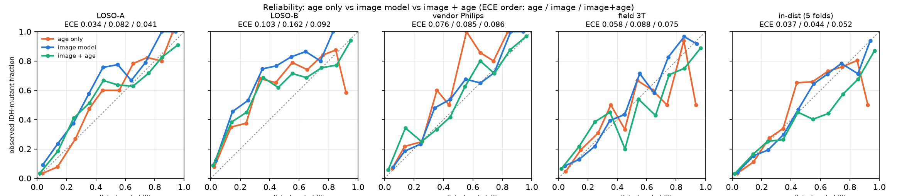

*図8 — 信頼度図（10 ビン）。橙：年齢のみ、青：画像モデル、緑：画像 + 年齢。各パネル上の数値は ECE（年齢のみ / 画像 / 画像 + 年齢）。分布内は 5 fold をまとめて描いた。年齢のみの高確率帯（0.8 以上）は症例が少ないので、点の揺れが大きい。*

- **年齢のみも、分布外では過小評価になる**：LOSO-B の切片は +0.99 だった。有病率が 11.7% から 28.4% へ上がったぶんを、年齢分布の違いだけでは説明しきれていない。事前の見込みは +0.5 前後（予測平均 19.5% 対 実際 28.4%）で、実際の切片はそれより大きかった。画像モデルの切片（+1.46）は 3.1 節のビン単位の測定（+1.42）とほぼ一致し、年齢のみはそのおよそ 3 分の 2 にあたる
- **年齢のみの形はおおむね正しい**：スロープの平均は分布外 1.02、分布内 1.01 だった。分布外での崩れは主に切片で、3.3 節の「崩れの正体は切片」という見方は年齢のみのモデルにも当てはまる
- **足し算の画像 + 年齢は過信になる**：スロープは 9 ユニットすべてで 1 を下回った（0.60〜0.84、分布内平均 0.70）。分布内では切片も負（−0.30）で、確率を高く出しすぎている。画像モデルはすでに年齢を入力に持っているので、外から年齢を足すと、年齢の情報の一部を二重に数えることになると考えられる。このため、AUC では画像 + 年齢が最良でも、ポータルの確率値としてこの足し算をそのまま使うのは勧められない。使うならスロープの補正も併せて要る。分布外の ECE（0.073）が画像モデル単体より良いのは、足した年齢項が切片のずれの一部（+0.73 → +0.60）を埋めたためと考えられる。形の較正が良くなったわけではない

### 3.3 崩れの正体は切片（RQ2）

**事後較正の比較（分布外 12 ランの平均 ECE）**

| 操作 | 何を直すか | ECE |
|---|---|---|
| 補正なし | — | 0.104 |
| 温度スケーリング（T 平均 0.992） | 傾き | 0.101 |
| evidence 定数縮小 | 確信度の水準 | 0.103 |
| prior オラクル（test の有病率が既知と仮定） | 切片 | **0.072** |

切片を持たない操作はどれも効かず、切片の操作だけが効いた。温度は inner-val でフィットするが、inner-val は train と同じ分布なので、シフトの後に生じるずれはそこからは見えない。LOSO-B ではオラクルで 0.162 → 0.061 となり、分布内の水準を下限とみなすと、崩れの 86%（ECE ベース）が有病率のずれで説明できる。

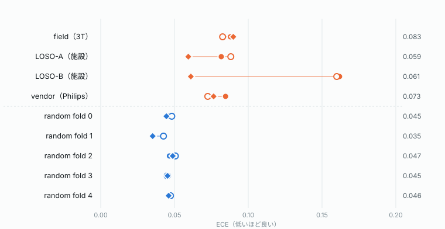

*図9 — 補正なし・温度スケーリング・prior オラクルの ECE（3 seed 平均）。右端の数値は 3 手法のうち最も良い値。温度スケーリングはほとんど動かず、切片を動かすオラクルだけが効く。*

**実験 A（特徴空間の分解）**
- 施設シフトでは `Δ_null` が支配的だった（雑音床の 2.6〜9.5 倍）。表現は施設をはっきり分けているのに、ヘッドが読む平面にはほとんど乗っていない
- 撮像シフトでは、動いた分がヘッドの読む平面に入る。field は**有病率がほぼ変わらない（28.2% → 27.2%）のに、融合ロジットが −0.33 動いた**。vendor では T2 の evidence が −20%、FLAIR が −27% 減った
- LOSO-B を層別すると、症例構成が判別方向を +0.13〜+0.42σ 押し上げ、撮像（T2 / FLAIR / 統合）が −0.24〜−0.43σ 押し下げて、互いに打ち消し合っていた
- → 切片のずれは**症例構成由来（共変量で推定できる）と撮像由来（共変量では推定できない）の和**である

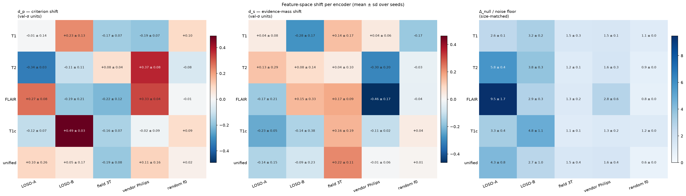

*図10 — エンコーダごとの特徴空間シフト（`notebooks/05_shift_decomposition.ipynb`、3 seed の平均 ± sd）。左：判別方向の移動 `d_p`、中：確信方向の移動 `d_s`（いずれも val の σ 単位）、右：ヘッドから見えない成分 `Δ_null` の雑音床に対する比。施設シフト（LOSO）では右パネルが大きく、撮像シフト（field / vendor）では雑音床に近い。*

**実験 B・C**
- ヘッドの除去は較正を部分的に改善した（LOSO-B は T2・FLAIR を外すと 0.162 → 0.073）。ただし vendor では悪化し、true-missing では AUC が −0.020 下がった（改善は 12 ラン中 1 ラン）。除去が効いたのは偶然に部分的な切片補正として働いたからで、外すヘッドの `d_p` の符号で効くかどうかを事前に予測できる
- 症例ごとの分布外スコアで source と shifted を見分ける AUC は 0.53〜0.63 で、ほぼ偶然と変わらない。誤答の予測でもモデル自身の S（0.68〜0.77）を一度も超えなかった。症例単位のゲートに伸びしろは無い
- evidence の縮小は効かず、推定された c は seed 間で 0.40〜1000 と不安定だった。**自信過剰仮説は棄却される**

### 3.4 ラベル無しの切片推定（RQ3）

**EM は原理的に失敗する** 27 ランすべてで収束し、分布内では誤差 0〜3pt と正確だったのに、分布外では LOSO-B が真値 28.4% に対して 14.6%、LOSO-A が真値 20.6% に対して 6.6% と大きく外れた。LOSO-A ではオフセットの符号まで逆になった。LOSO-B の test では、予測確率の平均が 12.3% なのに真の有病率は 28.4% で、両者が逆向きに動いている。つまりラベルシフトの仮定（p(x|y) が不変）が破れている。EM はシフトで歪んだ予測分布だけを材料にするので、その歪みを推定できない。

**共変量による比方式** 年齢だけでは、有病率シフトのうち LOSO-A の 81%、LOSO-B の 46% しか説明できない。UCSF と UTSW の年齢分布は区別できない（KS p = 0.41）のに、有病率は 7.9pt 違うからである。疑い（grade）を加えると LOSO-B で 96% まで説明でき、ECE は 0.063 になった（オラクル 0.061）。CBTRUS の外部表は、絶対値として使うと逆効果だった（LOSO-A 0.082 → 0.105）。訓練側と目標側を同じ表に通して比を取ると、LOSO-B のオフセットは +1.05（オラクル +1.09）、ECE 0.062 となった。

**主結果：補正法ごとの全例 ECE（3 seed 平均）**

| 手法 | LOSO-A | LOSO-B | field | vendor | in-dist |
|---|---|---|---|---|---|
| 補正なし | 0.082 | 0.162 | 0.088 | 0.085 | 0.044 |
| EM | 0.141 | 0.141 | 0.115 | 0.114 | 0.059 |
| 比方式・年齢のみ | 0.074 | 0.105 | 0.091 | 0.096 | 0.045 |
| 比方式・年齢 + 疑い | 0.070 | 0.064 | 0.090 | 0.092 | 0.044 |
| 出力整合・年齢のみ | 0.037 | 0.090 | 0.074 | 0.100 | 0.045 |
| **出力整合・年齢 + 疑い** | **0.038** | **0.042** | **0.070** | 0.092 | 0.044 |
| 全例ラベル切片（参照） | 0.042 | 0.045 | 0.078 | 0.086 | 0.043 |
| b̂（出力整合） | +0.77 | +1.42 | +0.20 | +0.05 | +0.03 |
| b̂（全例ラベル） | +0.84 | +1.46 | +0.28 | +0.35 | +0.04 |

- 出力整合（年齢 + 疑い）は、**ラベル 0 例のまま、全例ラベル切片という下限に到達した**。LOSO-A / LOSO-B でわずかに下回っているのは、全例ラベル切片が NLL 最適であって ECE 最適ではないためで、差は 10 ビン ECE の揺らぎの範囲に収まる（「ラベルありを超えた」とは読まない）
- field では、比方式が捉えられなかった撮像由来のずれ（−0.33）を、符号まで含めて回収した（b̂ = +0.20）
- **b̂ の内訳**：LOSO-B の +1.42 = 比方式（症例構成）+1.07 ＋ 共変量で説明できない分 +0.35（seed 間 sd 0.25）。後者は実験 A で見つかった撮像由来の押し下げと符号が対応する
- 分布内では b̂ ≈ 0 で、何も動かさない（正しい挙動）
- 頑健性：疑いを 15% 誤読しても LOSO-B は 0.048、50% 欠損でも 0.056 で、比方式（0.068 / 0.080）より劣化が小さい

### 3.5 少数例での安定性とゲート

**N 例で推定したときの ECE / P(害)（ゲートなし、残り症例で評価）**

| N | LOSO-B 出力整合 | LOSO-B ラベルあり | LOSO-A 出力整合 | LOSO-A ラベルあり |
|---|---|---|---|---|
| 10 | 0.086 / 11% | 0.106 / 19% | 0.075 / 37% | 0.087 / 44% |
| 20 | 0.065 / 1% | 0.078 / 8% | 0.061 / 23% | 0.075 / 41% |
| 50 | 0.059 / 0% | 0.063 / 1% | 0.052 / 12% | 0.059 / 21% |
| 100 | 0.055 / 0% | 0.058 / 0% | 0.049 / 6% | 0.052 / 12% |

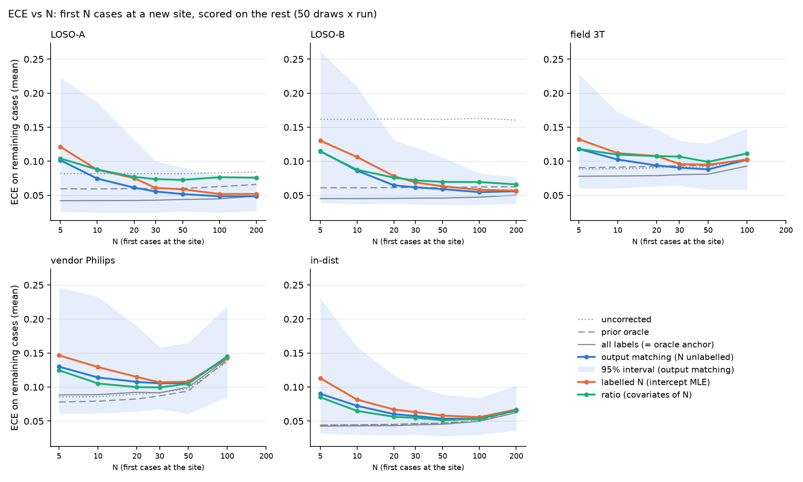

*図11 — 目標施設の最初の N 例でオフセットを推定し、残りの症例で測った ECE（`notebooks/06_output_matching.ipynb`、50 回 × 3 seed）。青：出力整合（ラベル無し）、橙：N 例ラベルの切片、緑：比方式。帯は出力整合の 95% 区間。灰色の点線は補正なし、実線は全例ラベル切片（下限）。横軸は対数目盛。field / vendor の N = 100 は残り症例が少なく、ECE が小標本バイアスで跳ねる。*

**ラベル無しのほうが、ラベルありより少ない N で安定した**（図11）。LOSO-B では、ラベル無し 20 例がラベルあり 44 例に相当する。理由はこう考えられる。ラベルありの推定は Σ y_i を使うので、1 例ごとにベルヌーイの雑音が乗る。出力整合はその y_i を、共変量が与えられたときの条件付き期待値 π(a_i, g_i) に置き換えている。条件付き期待値で置き換えると推定量の分散は下がる（Rao–Blackwell 化）。その代わり、π のモデルが外れているとバイアスが入る（vendor の節を参照）。

一方、**補正すべきずれの小さい条件では、ゲートなしの補正は害になりやすい**。N = 20 での P(害 > 0.01) は in-dist 47%、vendor 55%、field 27% だった。

**有意性ゲートのトレードオフ（N ≥ 20 での最悪値）**

| k | in-dist 害>.01 | vendor 害>.01 | field 害>.01 | LOSO-A 利得損失 | LOSO-B 利得損失 | 規則 |
|---|---|---|---|---|---|---|
| なし | 47% | 55% | 29% | 0 | 0 | — |
| 2.0 | 11% | 7% | 9% | +0.010 | +0.005 | × |
| **2.5** | **6%** | **3%** | **5%** | +0.013 | +0.011 | **○** |

事前に固定した規則で選ばれるのは **k = 2.5、N_min = 20** である。

- N = 20 での発火率：LOSO-B 59%、LOSO-A 22%、field 9%、vendor 3%、in-dist 6%。ずれの無い条件ではほぼ閉じたままで、閉じているのが正解である
- 代償は LOSO-B で払う。N = 20 では ECE 0.100（ゲートなしなら 0.065）。N = 30 では発火 82%・ECE 0.077、N = 50 では発火 95%・ECE 0.063 で、利得はほぼ戻る
- 事前予測は 4 つ中 2 つ外れた（LOSO-B の N = 20 は「ほぼ常に発火」と予測したが実際は 59%、field は「N とともに発火が増える」と予測したが増えなかった）

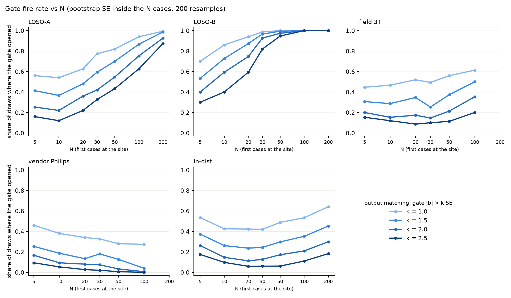

*図12 — ゲートの発火率（N 例の中で 200 回の復元抽出、`notebooks/07_gated_correction.ipynb`）。線の濃さが k（1.0〜2.5）。ずれの大きい LOSO-B では N とともにほぼ 100% に達し、ずれの無い vendor と in-dist では低いまま保たれる。*

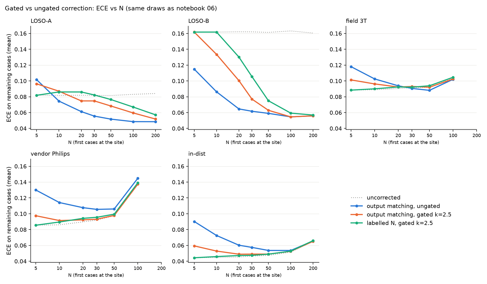

*図13 — ゲートあり・なしの ECE（図11 と同じ抽出）。青：出力整合・ゲートなし、橙：出力整合・ゲート k = 2.5、緑：N 例ラベル・ゲート k = 2.5、灰色の点線：補正なし。ゲートは vendor と in-dist の悪化を抑える一方、LOSO-B では N ≤ 30 で利得の一部を失う。*

`【要判断】` k = 2.5 / N_min = 20 の採否は未確定。k = 2.0 は in-dist の 11% で、基準をわずかに満たさない。

---

## 4. 考察

### 4.1 どの補正が最も有望か

本研究で試した補正法は、次の 4 段に整理できる。

1. **切片を持たない補正**（温度、evidence 縮小）：効かない。問題の形に合っていない
2. **予測分布だけからのゼロショット推定**（EM）：原理的に失敗する。歪みを歪んだものから推定することはできない
3. **共変量で有病率を推定して比を取る**（比方式：年齢、年齢 + 疑い、CBTRUS）：症例構成由来のずれは直せる。撮像由来のずれは見えない
4. **共変量で有病率を決め、モデル出力で切片を解く**（出力整合）：両方を一度に吸収し、ラベル 0 例のまま全例ラベル切片の水準に届く

**現時点で最も有望なのは「出力整合（年齢 + 疑い）＋有意性ゲート（k = 2.5、N_min = 20）」である。** 理由は 4 つある。

- 精度：ラベル無しで下限に到達する（LOSO-B 0.042、LOSO-A 0.038）
- サンプル効率：ラベルありの約 2 倍の効率で安定する
- 安全性：ゲートによって、ずれの無い施設で害が出る確率を 3〜6% に抑えられる
- 運用コスト：施設側の負担は、年齢と疑いの 1 問だけ

### 4.2 なぜ出力整合が効くのか

EM が失敗したのは、有病率の推定がモデルの出力を経由する循環になっていたからである。比方式が届かなかったのは、モデル出力を一切見ないからである。出力整合はこの 2 つの間に位置する。「目標施設の有病率はいくつか」は、シフトで歪まない共変量（年齢と臨床の読影）に任せる。「今のモデルの出力はその値からどれだけずれているか」は、モデル自身の出力で測る。役割をこのように分けると、症例構成と撮像という向きの違う 2 つの力の差し引きをまとめて測れる。

### 4.3 限界

- **vendor（Philips）は切片では直らない**：出力整合は 0.092 で、補正なし（0.085）よりわずかに悪い。原因は係留点の誤差で、共変量による有病率 `π̂_cov` = 30.9% に対して真値は 35.0% だった。係留点を真値に差し替えると b̂ は +0.05 → +0.35 になる。ただし真値で係留しても ECE は 0.086 で、補正なしと変わらない。vendor の較正誤差はそもそも切片の問題ではなく、確率の形の歪み（T2 / FLAIR の evidence 減少）である。ゲートを入れると N = 20 で P(害) は 81% → 3% に下がる（発火 3%）ので、運用上の害は抑えられる
- **疑いの代用**：評価では確定 grade の 2 値化を疑いの代わりに使った。実際の術前読影の精度は検証していない（15% の誤読と欠損に対する頑健性は確認した）
- **規模**：施設は米国の 3 つだけで、test になれるのは 2 施設。分布外のランは 4 ユニット × 3 seed = 12 本で、報告している差（AUC 0.02 程度）は seed 間のばらつきと同じオーダーである
- **年齢 × IDH 関係のサイト不変性**に依存する。小児や他地域では別途の検証が要る
- **画像を使わない比較対象は年齢 1 変数だけ**：性別のみ・年齢 + 性別のモデルは評価していない。画像 + 年齢のスコアは足し算で作ったもので、学習し直したモデルではない。この足し算は過信になる（スロープ 0.60〜0.84、3.2 節）
- **評価は推論のみ**：エンコーダ側でシフトを起こさない設計（T2 / FLAIR の輝度アフィン不変な拡張など）や、ヘッド構成の見直しは再学習を伴うため、まだ測っていない
- ECE は 10 ビン等幅で、症例が少ない評価集合（vendor の N = 100 で残り 40 例など）では小標本バイアスで値が跳ねる

---

## 5. OpenIDH ポータルの定義（提案）

ここまでの結果から、ポータルが返すものと施設ごとの状態管理は次の形が望ましいと考える。

### 5.1 入力

| 項目 | 必須 | 用途 |
|---|---|---|
| T1 / T2 / FLAIR / T1c（欠けていてもよい） | ◯（最低 1 シーケンス） | 画像 evidence。欠けたシーケンスは和から抜け、S が下がる |
| 腫瘍セグメンテーション（ポータル側で自動生成も可） | ◯ | スライス選択と体積スケーリング |
| 年齢・性別 | ◯ | tabular head と π(·) |
| **術前の高悪性度疑い（はい／いいえ／不明）** | 任意（強く推奨） | π(年齢, 疑い)。不明なら年齢のみで計算する |
| 施設 ID | ◯ | 施設ごとのオフセットの管理 |
| ベンダー・磁場強度（DICOM ヘッダから） | 自動取得 | 記録のみ。将来の撮像由来ずれの解析用 |
| 確定診断（後から登録） | 任意 | 検証用。補正には使わない（6 章の課題を参照） |

### 5.2 出力（1 症例ごと）

1. **順位情報**：施設内パーセンタイル、または未補正のスコア。AUC 0.85〜0.87 はシフト下でも保たれるので、常に信頼できる情報として出す
2. **不確実性 S**（または Beta 分布の 95% 区間）：誤答時に下がることは 27 / 27 ランで確認済み。「この症例は自信が無い」という警告として使う。ただし施設が変わったことの検知には使えないと明記する
3. **確率値** `σ(z_i + b_site)`：施設オフセットを適用した値
4. **補正状態の表示**（常時）：「補正なし（初期値：12/20 例）」「補正あり：オフセット +1.38（SE 0.41、N = 47）」「補正なし：ずれの証拠なし」のいずれか
5. **年齢のみのベースライン確率**（参考表示）：画像モデルがどれだけ上乗せしているかを利用者が確かめられるようにする

### 5.3 施設オフセットの更新規則

```python
# 施設に新しい症例が届くたびに再評価する（ラベル不要）
def site_offset(cases, k=2.5, N_min=20, n_boot=200):
    if len(cases) < N_min:
        return 0.0, "補正なし（初期値）"
    z  = [log(c.alpha / c.beta) for c in cases]
    pi = [pi_age_susp(c.age, c.suspicion) for c in cases]   # 訓練施設で当てた固定モデル
    b  = solve(mean(sigmoid(z + b)) == mean(pi))            # 出力整合
    se = sd(bootstrap(b, within=cases, n=n_boot))
    if unstable(boot) or abs(b) <= k * se:
        return 0.0, "補正なし：ずれの証拠なし"
    return b, f"補正あり：{b:+.2f}（SE {se:.2f}, N={len(cases)}）"
# S = α+β は変えない。AUC・順位は不変
```

- オフセットは**施設ごと**に 1 つ持つ（装置ごとではない。vendor の結果から、装置差は切片では吸収できないため）
- 補正なしの間は、次の但し書きを出す。「この確率値は他施設のデータで学習したモデルによるもので、当施設の頻度が異なると系統的にずれます。症例間の順位づけは保たれますが、確率値をそのまま閾値判断に使わないでください」
- 確定診断が登録されたら、オフセットの事後検証（実測陽性率との比較）に使う。ただし補正の主経路はラベル無しのまま保つ

### 5.4 ポータルに入れないもの

- 温度スケーリングと EM：本研究で無効または有害と確認した
- 症例ごとの分布外スコアによる拒否：判別力がほぼ偶然と同じだった
- CBTRUS 表を絶対的な有病率として使うこと：比として使う場合だけ機能する

---

## 6. 結論と今後の課題

施設をまたぐと、IDH 予測モデルの順位付けは保たれるが、確率の目盛りは定数のロジットオフセットとしてずれる。このずれは症例構成由来と撮像由来の和で、術前に得られる共変量と目標施設の未ラベル症例だけから、出力整合によって推定できる。有意性ゲートを組み合わせれば、補正の要らない施設に害を出さずに運用できる。

今後の課題：

1. `【要判断】` k = 2.5 / N_min = 20 の確定。LOSO-B の N = 20 での利得損失を減らす案として、N とともに逐次判定する方式や、k を N に依存させる方式がある（事前固定した規則の外なので、新しい評価として切り分ける）
2. vendor 型の形の歪みへの対処：エンコーダ側の不変化（T2 / FLAIR の輝度拡張）または形の補正
3. 実際の術前読影による疑いの精度評価
4. seed の追加と、米国外施設での外部検証
5. 年齢を活かせるヘッド設計（学習率の分離で感度は改善した。AUC への効果は未確定）

---

## 付録：出典ファイル

| 内容 | ファイル |
|---|---|
| Stage B 全 27 ラン、温度・オラクル・EM・N 例曲線・年齢・学習率 | `results/stageb-report.md` |
| 画像を使わないモデル（年齢のみ）との比較 | `results/age_prior.json`（`auc_table`）、`scripts/age_prior_eval.py`、`results/stageb-report.md`。較正は `results/age_baseline_calibration.{md,json}`、`scripts/age_baseline_calibration.py`、`notebooks/08_age_baseline_calibration.ipynb` |
| 実験 A〜C のまとめ | `results/domain_shift_summary.md`、`results/shift_decomposition_report.md`、`results/head_ablation_report.md` |
| 出力整合 | `results/output_matching.md`、`openidh_model/eval/output_matching.py` |
| 有意性ゲート | `results/gated_correction.md`、`openidh_model/eval/gated_correction.py` |
| 図（notebook 由来） | 図1 `notebooks/01_data_check.ipynb`（出力から抽出 → `results/figures/data_check_inputs.png`）、図10 `05_shift_decomposition`、図11 `06_output_matching`、図12・13 `07_gated_correction`、図8 `08_age_baseline_calibration` |
| 図（Stage B レポート由来） | 図4〜7・9 `results/figures/fig-01, 03, 06, 08, 02.svg`（`build_report.py` が生成） |
| 図（本草稿で新規作成） | 図2 `results/figures/model_architecture.svg`、図3 `results/figures/beta_width.svg`（設計書と fusion.py の実装をもとに作図） |
| 分割の定義 | `data/preprocessed/v1.0.0/_global/splits/README.md` |
| モデル設計 | `markdown/MODEL_DESIGN_v1.md`、`markdown/IMPLEMENTATION_SPEC_v1_1.md` |
