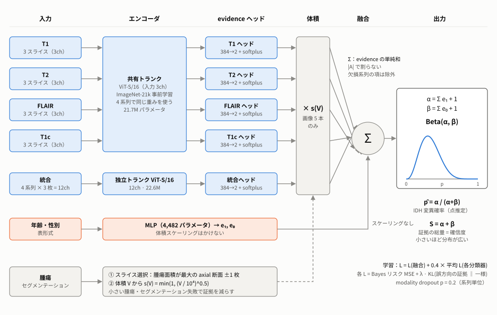
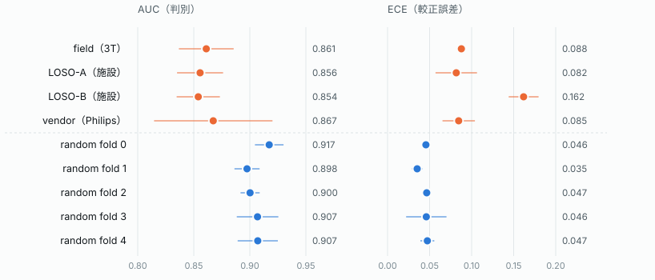
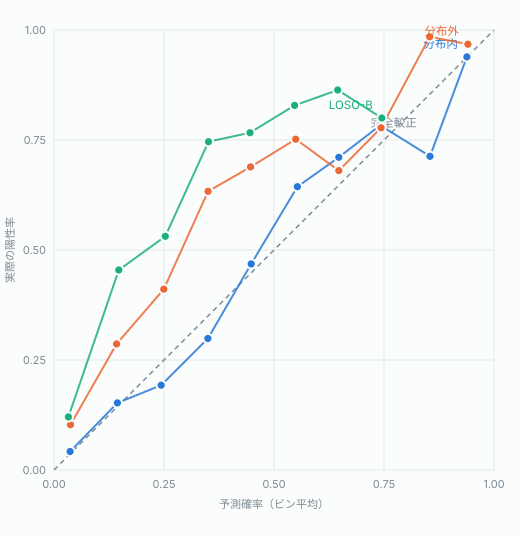
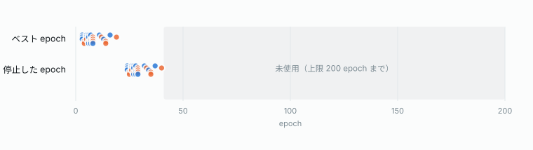
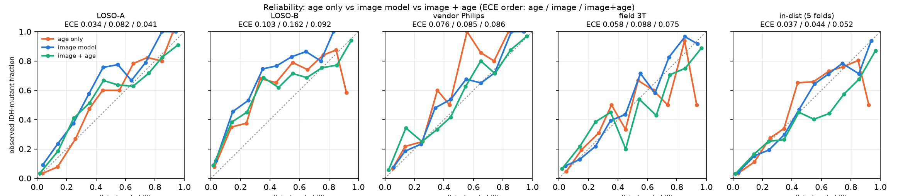
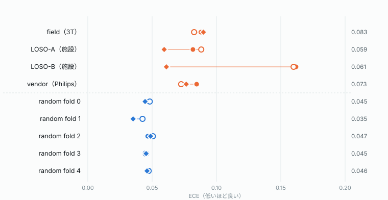
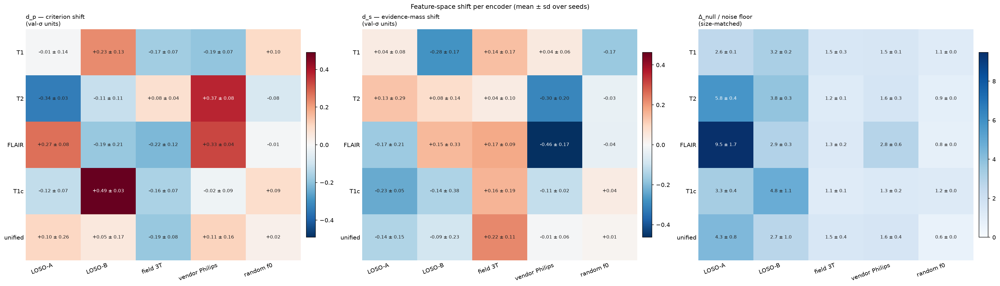
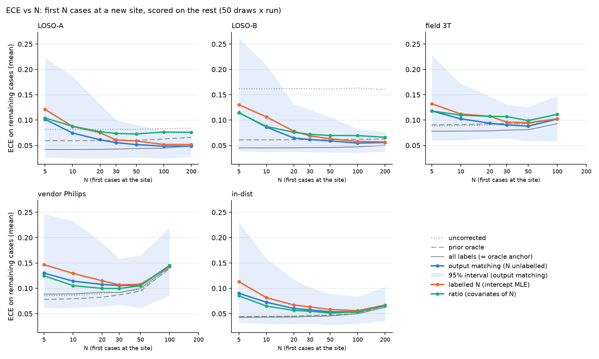
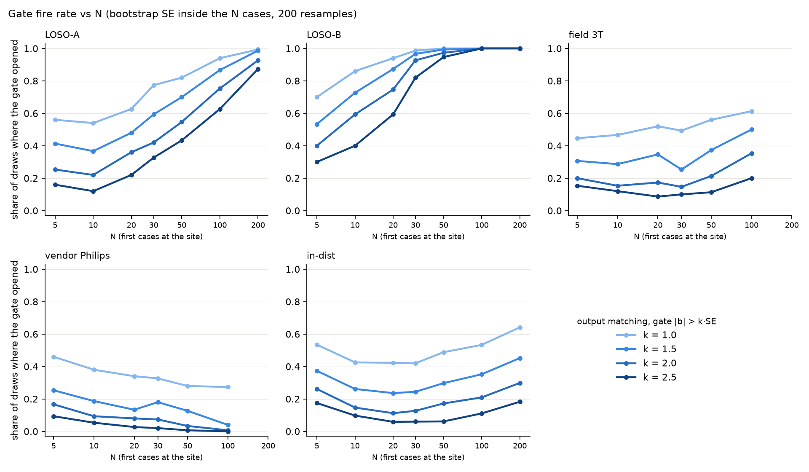
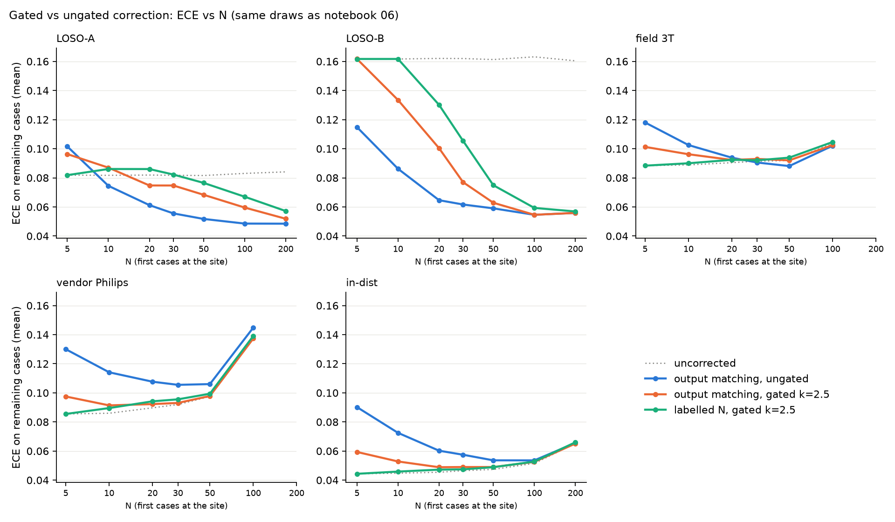

<!-- _class: lead -->
<!-- _paginate: false -->
<!-- _header: '' -->

# 施設間シフト下における MRI からの IDH 変異予測

## 判別は保たれ、較正はラベル無しの切片補正で回復する

OpenIDH プロジェクト　草稿 v0.4（2026-10-21）

数値は `results/manuscript_draft.md` とその出典レポートから転記

---

## 背景と問い

- IDH 変異は WHO 2021 分類の中核。術前 MRI から非侵襲に予測できれば手術計画に役立つ
- 公開ポータルは、**学習に使っていない施設**から症例が来ることが前提。その施設のラベルはふつう無い
- 臨床で使う条件は 2 つ
  1. 未知の施設でも順位付けが崩れない（**判別**）
  2. 出力された確率値をそのまま読める（**較正**）

| | 問い |
|---|---|
| **RQ1** | 施設・装置が変わったとき、判別と較正はそれぞれどれだけ劣化するか |
| **RQ2** | 較正の劣化の正体は何か（確信度の過剰か、切片のずれか、形の歪みか） |
| **RQ3** | 目標施設のラベル無しで較正を取り戻せるか。安全に運用する規則は何か |

---

<!-- _class: dense -->

## データと評価ユニット

| 施設 | n | 変異 | 変異率 | 備考 |
|---|---|---|---|---|
| UCSF-PDGM | 501 | 103 | 20.6% | 495 患者 |
| UTSW | 619 | 176 | 28.4% | 複数ベンダー・磁場強度が混在 |
| UPenn-GBM | 515 | 16 | 3.1% | GBM 限定。test には使わない |
| **計** | **1,635** | **295** | **18.0%** | |

| ユニット | 種類 | test | train | test の変異率（inner-val） |
|---|---|---|---|---|
| LOSO-A | 施設シフト | UCSF（501） | UTSW + UPenn | 20.6%（16.7%） |
| LOSO-B | 施設シフト | UTSW（619） | UCSF + UPenn | 28.4%（11.8%） |
| vendor | 撮像シフト | UTSW Philips（140） | UTSW 他ベンダー | 35.0%（26.0%） |
| field | 撮像シフト | UTSW 3T（195） | UTSW 1.5T ほか | 27.2%（28.2%） |
| in-dist | 対照 | ランダム 5-fold（各 327） | 残り 4 fold | 約 18% |

各ユニット 3 seed、計 27 ラン。前処理：1 mm 等方、腫瘍最大断面とその上下 1 枚の計 3 枚を 3ch 入力

---

<!-- _class: fig dense -->

## モデル：evidential late fusion

- 6 つの分類器（計 44.2M パラメータ）
  - T1 / T2 / FLAIR / T1c：**共有トランク** ViT-S/16
  - 統合（12ch）：独立トランク
  - 年齢・性別：MLP
- 各分類器が変異・野生型の**証拠**を出し、**足すだけ**で Beta(α, β) を作る

$$
\hat p = \tfrac{\alpha}{\alpha+\beta},\quad S = \alpha+\beta,\quad z = \log\tfrac{\alpha}{\beta}
$$

- 欠けたシーケンスは和から抜け、S が下がる
- 較正補正は z に定数 b を足すだけ → **AUC と S は不変**

---

<!-- _class: dense -->

## 較正補正法の 4 系統

| 系統 | 手法 | 目標施設で使う情報 | 推定するもの |
|---|---|---|---|
| (i) inner-val でフィット | 温度スケーリング／evidence 定数縮小 | なし | 傾き T／確信度 c |
| (ii) 有病率を推定して比を取る | EM（SLD 法） | 予測確率の分布 | 有病率 |
| | 比方式（年齢／年齢 + 疑い／CBTRUS） | 共変量・外部表 | 有病率比 |
| **(iii) 出力整合（提案法）** | 年齢 + 疑い | 共変量 + **モデル自身の出力** | 切片 b を直接 |
| (iv) ラベルあり | N 例ラベルの切片 | N 例の確定診断 | 切片 b |
| | オラクル／全例ラベル切片 | 全例の確定診断 | 参照値（配備不可） |

- **疑い**：「術前画像で高悪性度（grade 4）を疑うか」の 1 問。評価では確定 grade の 2 値化で代用
- 評価指標：AUC、ECE（10 ビン等幅）、Brier、NLL、較正切片・スロープ、誤答と正答の S の比較

---

<!-- _class: fig dense -->

## RQ1：判別は保たれ、較正は崩れた

| ユニット | AUC | ECE |
|---|---|---|
| LOSO-A | 0.856 | 0.082 |
| LOSO-B | 0.854 | **0.162** |
| vendor | 0.867 | 0.085 |
| field | 0.861 | 0.088 |
| in-dist | 0.906 | 0.044 |

- AUC は 4 種のシフトで 0.854〜0.867 に揃う
- ECE は分布外平均 0.104、分布内の **2.4 倍**
- AUPRC の lift は 4.09 → 2.62（−36%）

---

<!-- _class: fig dense -->

## 崩れは「定数のロジットオフセット」の形

- 分布外の信頼度図は、どの確率帯でも対角線より上（**過小評価**）
- LOSO-B のずれをロジットで測ると、ビンをまたいで **+1.42 ± 0.17 とほぼ一定**
- LOSO-B の test：予測平均 12.3% 対 実際 28.4%
- 不確実性 S：誤答例では 27 / 27 ランで正答例より低い（平均 −24%）。施設が変わっても −5% しか下がらない → **「間違い」には反応、「施設の変化」には反応しない**

---

<!-- _class: dense -->

## 年齢 1 変数との比較：AUC

| ユニット | 年齢のみ | 画像 | 画像 + 年齢 |
|---|---|---|---|
| LOSO-A | 0.904 | 0.856 | 0.919 |
| LOSO-B | 0.880 | 0.854 | 0.907 |
| vendor | 0.905 | 0.867 | 0.920 |
| field | 0.868 | 0.861 | 0.896 |
| **平均 分布外** | **0.889** | 0.860 | **0.910** |
| **平均 分布内** | 0.898 | 0.906 | **0.930** |

- 分布外では年齢のみが 4 ユニットすべてで画像を上回る
- 年齢はシフトで劣化しない（0.898 → 0.889）が、画像は劣化する（0.906 → 0.860）
- 画像の正味の寄与は**年齢への上乗せ**として測る：分布外 +0.021、分布内 +0.032

---

<!-- _class: dense -->

## 年齢のみとの比較：較正（notebook 08）

| ユニット | ECE 年齢 | ECE 画像 | ECE 画像+年齢 | 切片 年齢 | 切片 画像 | スロープ 年齢 | スロープ 画像+年齢 |
|---|---|---|---|---|---|---|---|
| LOSO-A | **0.034** | 0.082 | 0.041 | +0.07 | +0.84 | 1.18 | 0.81 |
| LOSO-B | 0.103 | 0.162 | **0.092** | +0.99 | +1.46 | 0.77 | 0.65 |
| vendor | **0.076** | 0.085 | 0.086 | +0.58 | +0.35 | 1.26 | 0.84 |
| field | **0.058** | 0.088 | 0.075 | +0.03 | +0.28 | 0.89 | 0.63 |
| **平均 分布外** | **0.068** | 0.104 | 0.073 | +0.42 | +0.73 | 1.02 | 0.73 |
| **平均 分布内** | **0.037** | 0.044 | 0.052 | +0.02 | +0.04 | 1.01 | 0.70 |

- 分布外の ECE は、4 ユニットすべてで年齢のみ < 画像
- 年齢のみも LOSO-B では過小評価（切片 +0.99、画像の約 2/3）。スロープはほぼ 1 → **崩れは主に切片**
- 足し算の画像 + 年齢は**全ユニットでスロープ < 1（過信）**。年齢の二重カウントと考えられる → 確率値としてそのままは使えない

切片：傾き 1 固定でロジットに足すべき量（正 = 過小評価）。スロープ：a + s·logit p の s（1 未満 = 過信）

---

<!-- _class: fig -->

## 信頼度図：年齢のみ・画像・画像 + 年齢

- 橙：年齢のみ　青：画像モデル　緑：画像 + 年齢。パネル上の数値は ECE（年齢 / 画像 / 画像 + 年齢）
- 画像 + 年齢は高確率帯で対角線の下に回り込む（過信）。年齢のみの 0.8 以上は症例が少なく揺れが大きい

---

<!-- _class: dense -->

## RQ2：崩れの正体は切片

| 操作（分布外 12 ラン平均） | 直すもの | ECE |
|---|---|---|
| 補正なし | — | 0.104 |
| 温度スケーリング | 傾き | 0.101 |
| evidence 定数縮小 | 確信度 | 0.103 |
| prior オラクル | **切片** | **0.072** |

- 切片を持たない操作は効かない
- LOSO-B ではオラクルで 0.162 → 0.061。崩れの **86%** が有病率のずれで説明できる
- **自信過剰仮説は棄却**（evidence 縮小の c は seed 間で 0.40〜1000 と不安定）

---

<!-- _class: fig dense -->

## 切片のずれ = 症例構成 ＋ 撮像（実験 A〜C）

- 施設シフト：表現は施設を分けているが、ヘッドが読む平面にはほとんど乗らない（Δ_null が雑音床の 2.6〜9.5 倍）
- 撮像シフト：field は有病率がほぼ同じ（28.2% → 27.2%）なのに融合ロジットが **−0.33** 動く
- LOSO-B：症例構成が +0.13〜+0.42σ、撮像が −0.24〜−0.43σ で打ち消し合う
- 症例単位の OOD スコアは AUC 0.53〜0.63 で、ほぼ偶然

---

## RQ3：ラベル無しの切片推定 — 何が失敗したか

**EM は原理的に失敗する**
- 分布内では誤差 0〜3pt と正確なのに、分布外では LOSO-B 14.6%（真値 28.4%）、LOSO-A 6.6%（真値 20.6%）
- 予測平均と真の有病率が逆向きに動く → ラベルシフトの仮定（p(x|y) 不変）が破れている
- 歪んだ予測分布だけを材料にするので、その歪みは推定できない

**共変量による比方式は届かない**
- 年齢のみで説明できる有病率シフトは LOSO-A 81%、LOSO-B 46%（UCSF と UTSW の年齢分布は区別できない、KS p = 0.41）
- 疑いを加えると LOSO-B で 96%、ECE 0.063
- ただし**撮像由来のずれは原理的に見えない**（モデル出力を見ないため）

---

## 提案法：出力整合（output matching）

目標施設の N 例について、**モデル出力の平均が、共変量から見積もった有病率に一致する**切片 b を解く

$$
\frac{1}{N}\sum_{i=1}^{N}\sigma\left(z_i + b\right) \;=\; \hat{\pi}_{\mathrm{cov}} \;=\; \frac{1}{N}\sum_{i=1}^{N}\pi\left(a_i, g_i\right)
$$

- 右辺：「有病率はいくつか」は、シフトで歪まない共変量（年齢 a、疑い g）に任せる
- 左辺：「今のモデルがそこからどれだけずれているか」は、モデル自身の出力で測る
- → 症例構成と撮像という**向きの違う 2 つのずれ**をまとめて吸収できる
- 左辺は b について狭義単調増加なので、解はただ 1 つ（brentq）
- 検算：右辺を真の有病率に置き換えると切片のみの MLE と一致（27 ランで最大差 3.1e-8）

---

<!-- _class: dense -->

## 主結果：補正法ごとの ECE（全例、3 seed 平均）

| 手法 | LOSO-A | LOSO-B | field | vendor | in-dist |
|---|---|---|---|---|---|
| 補正なし | 0.082 | 0.162 | 0.088 | 0.085 | 0.044 |
| EM | 0.141 | 0.141 | 0.115 | 0.114 | 0.059 |
| 比方式・年齢 + 疑い | 0.070 | 0.064 | 0.090 | 0.092 | 0.044 |
| 出力整合・年齢のみ | 0.037 | 0.090 | 0.074 | 0.100 | 0.045 |
| **出力整合・年齢 + 疑い** | **0.038** | **0.042** | **0.070** | 0.092 | 0.044 |
| 全例ラベル切片（参照） | 0.042 | 0.045 | 0.078 | 0.086 | 0.043 |
| b̂（出力整合） | +0.77 | +1.42 | +0.20 | +0.05 | +0.03 |
| b̂（全例ラベル） | +0.84 | +1.46 | +0.28 | +0.35 | +0.04 |

- **ラベル 0 例のまま、全例ラベル切片という下限に到達**（「ラベルありを超えた」とは読まない）
- field：比方式が捉えられない撮像由来のずれを、符号まで含めて回収（b̂ = +0.20）
- b̂ の内訳（LOSO-B）：+1.42 = 症例構成 +1.07 ＋ 共変量で説明できない分 +0.35
- 頑健性：疑いを 15% 誤読しても 0.048、50% 欠損でも 0.056

---

<!-- _class: fig dense -->

## 少数例での安定性

| N | LOSO-B 出力整合 | LOSO-B ラベルあり |
|---|---|---|
| 10 | 0.086 | 0.106 |
| 20 | 0.065 | 0.078 |
| 50 | 0.059 | 0.063 |
| 100 | 0.055 | 0.058 |

- LOSO-B では**ラベル無し 20 例 ≈ ラベルあり 44 例**
- 理由：y_i を条件付き期待値 π(a_i, g_i) に置き換えると分散が下がる（Rao–Blackwell 化）。代わりに π が外れるとバイアスが入る
- ただし、ずれの小さい条件では補正が害になりやすい：N = 20 の P(害 > 0.01) は in-dist 47%、vendor 55%

---

<!-- _class: dense -->

## 有意性ゲート：はっきりずれているときだけ補正

|b̂| > k × SE（N 例内のブートストラップ）かつ N ≥ N_min のときだけ補正する

| k | in-dist 害 | vendor 害 | field 害 | LOSO-A 利得損失 | LOSO-B 利得損失 | 規則 |
|---|---|---|---|---|---|---|
| なし | 47% | 55% | 29% | 0 | 0 | — |
| 2.0 | 11% | 7% | 9% | +0.010 | +0.005 | × |
| **2.5** | **6%** | **3%** | **5%** | +0.013 | +0.011 | **○** |

害 = P(ECE の悪化 > 0.01)、N ≥ 20 での最悪値。規則：すべての N・ユニットで害 < 10% を満たす k のうち、LOSO-B の利得損失が最小のもの

- N = 20 の発火率：LOSO-B 59%、LOSO-A 22%、field 9%、vendor 3%、in-dist 6%
- 代償は LOSO-B：N = 20 で ECE 0.100（ゲートなし 0.065）。N = 30 で 0.077、N = 50 で 0.063 とほぼ回復
- 事前予測は 4 つ中 2 つ外れた（LOSO-B の N = 20 の発火、field の N 依存）

> 【要判断】k = 2.5 / N_min = 20 の採否は未確定

---

<!-- _class: fig -->

## ゲートの効果

 

- 左：発火率。ずれの大きい LOSO-B では N とともにほぼ 100%、ずれの無い vendor・in-dist では低いまま
- 右：ECE。ゲートは vendor・in-dist の悪化を抑え、LOSO-B では N ≤ 30 で利得の一部を失う

---

## 考察：補正法の 4 段

1. **切片を持たない補正**（温度、evidence 縮小）：効かない。問題の形に合っていない
2. **予測分布だけからの推定**（EM）：原理的に失敗。歪みを歪んだものから推定できない
3. **共変量で有病率を推定して比を取る**（比方式）：症例構成由来は直る。撮像由来は見えない
4. **共変量で有病率を決め、モデル出力で切片を解く**（出力整合）：両方を一度に吸収

**最も有望：出力整合（年齢 + 疑い）＋ 有意性ゲート（k = 2.5、N_min = 20）**
- 精度：ラベル無しで下限に到達（LOSO-B 0.042、LOSO-A 0.038）
- サンプル効率：ラベルありの約 2 倍
- 安全性：ずれの無い施設で害が出る確率を 3〜6% に抑える
- 運用コスト：施設側の追加負担は「疑い」の 1 問だけ

---

<!-- _class: dense -->

## 限界

- **vendor（Philips）は切片では直らない**：出力整合 0.092 対 補正なし 0.085。係留点の誤差（π̂_cov 30.9% 対 真値 35.0%）に加え、真値で係留しても 0.086 → 確率の**形の歪み**（T2 / FLAIR の evidence 減少）。ゲートで P(害) は 81% → 3%
- **疑いの代用**：確定 grade の 2 値化で代用。実際の術前読影の精度は未検証（15% 誤読・欠損への頑健性は確認）
- **規模**：米国 3 施設、test になれるのは 2 施設。分布外 12 ラン。AUC 0.02 程度の差は seed 間ばらつきと同じオーダー
- **年齢 × IDH 関係のサイト不変性**に依存。小児・他地域は別途検証が要る
- **年齢以外の画像なしモデルは未評価**（性別のみ、年齢 + 性別）。画像 + 年齢は足し算で、過信になる（スロープ 0.60〜0.84）
- **評価は推論のみ**：シフトに強いエンコーダ設計やヘッド構成の見直しは再学習が要り、未測定
- ECE は 10 ビン等幅で、小さい評価集合では小標本バイアスで跳ねる

---

<!-- _class: tight -->

## OpenIDH ポータルの定義（提案）

**入力**：4 シーケンス（欠けてもよい）、腫瘍セグメンテーション、年齢・性別、**術前の高悪性度疑い（はい／いいえ／不明）**、施設 ID

**出力（1 症例ごと）**
1. **順位情報**（施設内パーセンタイル）：シフト下でも保たれるので常に出す
2. **不確実性 S**：誤答時に下がる警告として使う。施設の変化の検知には使えないと明記
3. **確率値** σ(z_i + b_site)：施設オフセットを適用した値
4. **補正状態の表示**（常時）：「補正なし（初期値：12/20 例）」「補正あり：+1.38（SE 0.41、N = 47）」「補正なし：ずれの証拠なし」
5. **年齢のみのベースライン確率**（参考表示）

**施設オフセットの更新規則**
- 新しい症例が届くたびに、ラベル無しで出力整合 → ゲート判定。オフセットは**施設ごと**に 1 つ
- 補正なしの間は「確率値をそのまま閾値判断に使わないでください」と但し書きを出す
- 確定診断は事後検証にだけ使い、補正の主経路はラベル無しのまま保つ

---

## 結論

- 施設シフト下でも **判別（AUC 0.86）は保たれる**が、**較正（ECE 0.104）は崩れる**
- 崩れの正体は**ほぼ定数のロジットオフセット（切片）**で、症例構成と撮像の 2 つの成分の和
- **出力整合**は、年齢と「疑い」の 1 問だけで、ラベル 0 例のまま全例ラベル切片と同じ水準まで較正を戻す
- **有意性ゲート**で、ずれの無い施設での誤補正を抑えられる
- 年齢 1 変数でも分布外の AUC 0.889・ECE 0.068。画像の価値は「年齢への上乗せ」として測るべき

**要判断**
- k = 2.5 / N_min = 20 の採否
- 疑いの代用（確定 grade の 2 値化）と vendor の書き方
